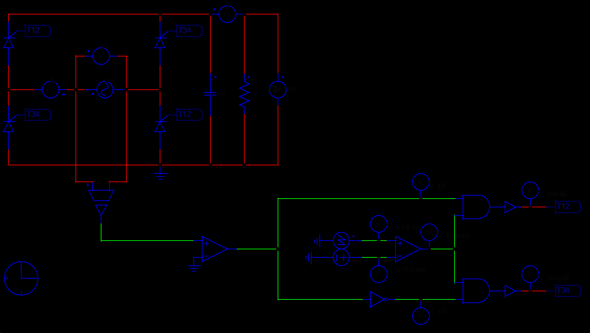
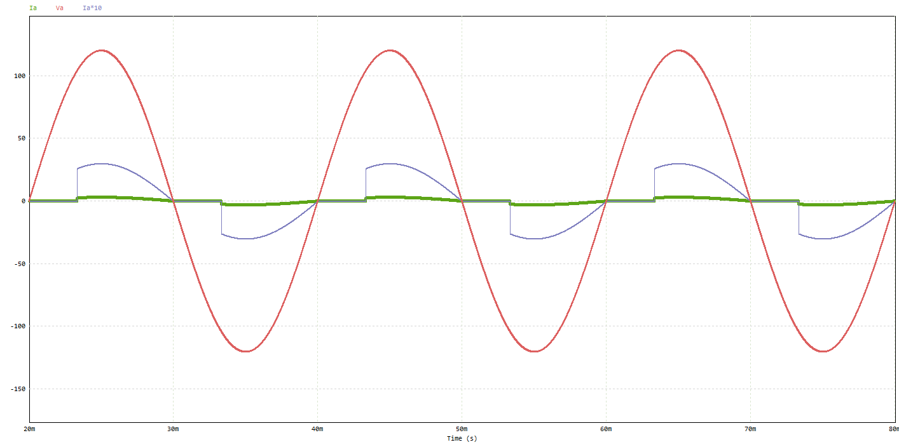
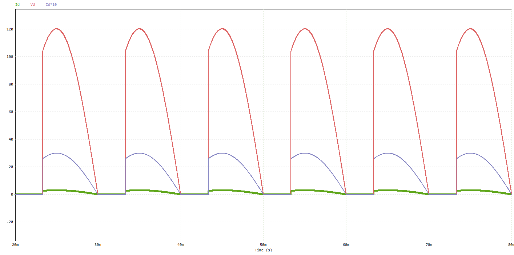
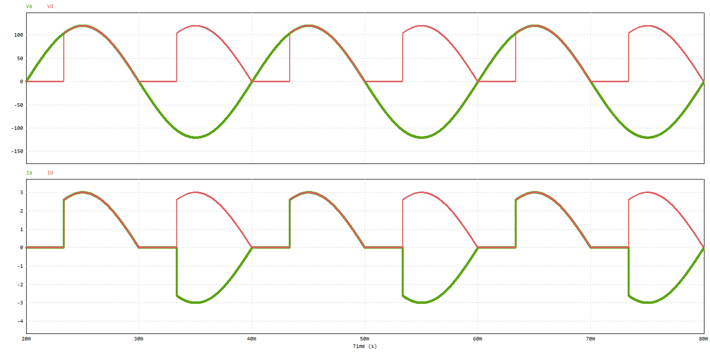
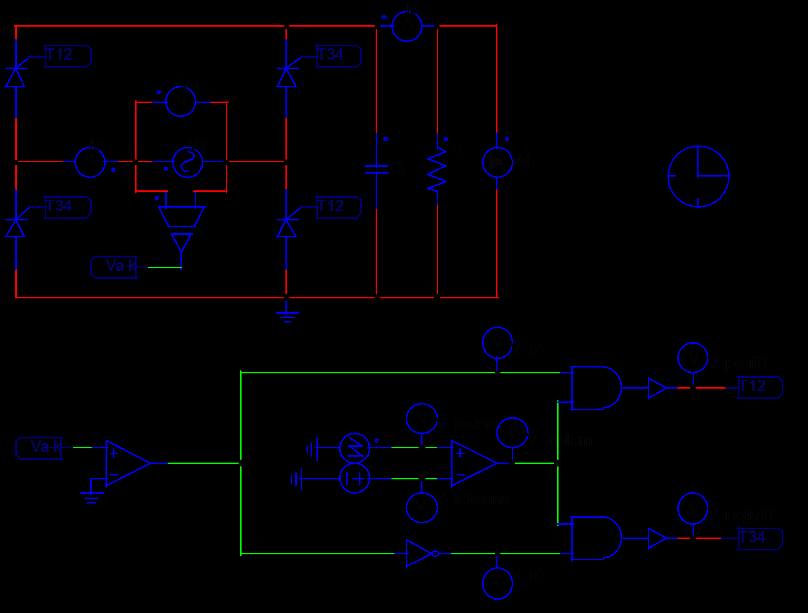

# ELM-3071-PSIM-Single-Phase-Controlled-Rectifier
Phase-controlled single-phase full-wave rectifier designed in PSIM for ELM-3071 Power Electronics. Includes gate firing circuit design, simulation report, and an alternative single-source control implementation.

## Design

- Input: 85 V rms, 50 Hz
- Firing angle: α = 60°
- Thyristor full bridge (T12 / T34) with a resistive load and an optional output filter capacitor
- Gate control: a zero-crossing comparator on the source voltage picks the half cycle, a sawtooth compared against a DC reference sets α, and two AND gates route the firing pulse to T12 or T34



Expected average output voltage:

```
Vm = 85 · √2 = 120.208 V
Vd = (Vm / π) · (1 + cos α) = 57.395 V
```

## Simulation Results

The waveforms below come from the lab version, which runs the same circuit
at the same operating point (85 V, α = 60°).

Grid voltage and grid current (current also shown ×10):



Output voltage and current:



Grid side and output side together: the output follows the grid voltage from
α = 60° in every half cycle, and the grid current reverses sign with the
negative half cycle while the output current stays positive.



Key results from the course report (resistive load):

| Quantity | Value |
|----------|-------|
| Average output voltage | 57.395 V |
| Output power | 145.24 W |
| Power factor | 0.897 |
| Input current (rms) | 1.906 A |
| Input current THD | 0.378 |

With the filter capacitor added, the average output rises to 99.94 V
(ripple 41.4 V), but the input current becomes a short, high peak
(16 A peak, 2.26 A rms).

## Versions

| Folder / file | Course | Notes |
|---------------|--------|-------|
| `1P-Contolled-FW-Rectifier.psimsch`, `Project Report.pdf` | ELM-3071 Power Electronics I (Fall 2025/26) | Full assignment: also includes THD, power factor and the capacitor-filtered case |
| `1P-Contolled-FW-Rectifier_PSIM-9.0.3.psimsch` | ELM-3071 | Same assignment, saved for PSIM 9.0.3 |
| `only main ac source.psimsch` | ELM-3071 | Alternative control that runs from the single main AC source |
| `lab/` | Power Electronics I Lab (Spring 2025/26) | Lab version of the same rectifier; the circuit was also built and tested in the lab experiment |

The lab assignment repeats the rectifier with the same input voltage and
firing angle, but its component values can differ from the course version.
Its report covers the output voltage, input power and unity-power-factor
current calculations with the simulation waveforms.



## Tools
PSIM
